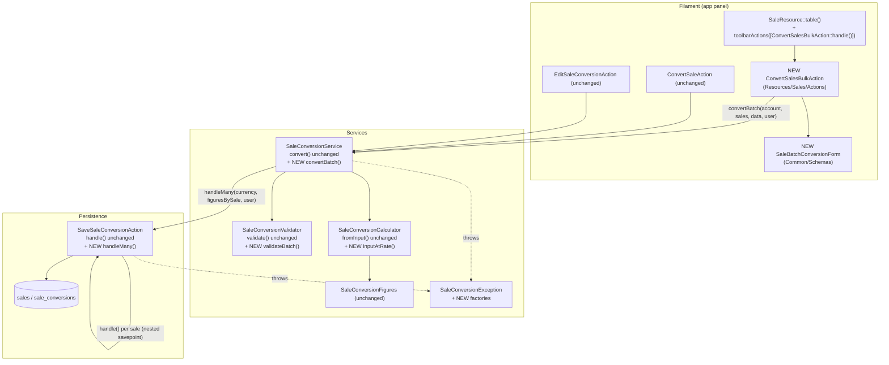
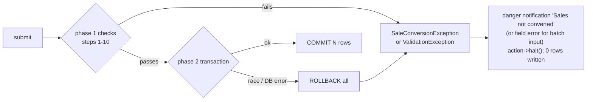
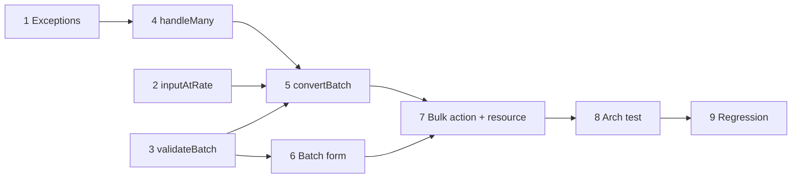

# Design: batch-sales-conversion (build 2026-10-11-batch-sales-conversion)

Inputs: `plan.md` (cited as **P§n** or by its IDs G*/N*/C*/S-in-*/T*/OQ*), `intake.md` (node IDs A.*, B.*, C.*, D.*), `intake-sources/user-clarifications.md` (**UC**).
Grounding: the single-sale conversion feature from commit 4ede53c (cited as `code:<path>`), plus `.ai/rules/services.md` and `.ai/rules/models.md`.

Note: the `architecture-diagramming` skill wasn't found under `.claude/skills/` in the worktree or under `D:\dara`. This design follows the Architect brief directly and uses Mermaid for diagrams.

---

## 0. Summary of decisions

| # | Decision | Plan / intake anchor |
|---|----------|----------------------|
| D1 | Entry point: a Filament `BulkAction` named `convertBatch` ("Convert selected") in the Sales table `toolbarActions`. | S-in-1, T1, A.1 |
| D2 | Batch input: `exchange_rate` (required), `fee_amount`, `tax_amount`, `conversion_note`. The rate turns into a per-sale `converted_amount`, which then goes through the **existing** validator and calculator unchanged. | S-in-2, T2, UC A.2, A.2/A.3 |
| D3 | Fee/tax semantics (OQ1), **proposed default:** the same absolute amount on each sale, in the account currency. This is isolated in one method so it can change cheaply. **Needs user confirmation at the gate.** | OQ1 |
| D4 | Unknown-currency sales (`currency_code` null) block the batch (OQ2 option a). | OQ2, B.5 |
| D5 | Two-phase execution. Phase 1 is in the service: guard, eligibility, validate, compute all figures, with **no writes**. Phase 2 is one DB transaction that locks every sale, re-checks eligibility under the lock, and saves each one. | C2, G3, T4, C.2 |
| D6 | The transaction lives in a new static `SaveSaleConversionAction::handleMany()`, not in `SaleConversionService`. The arch test forbids `DB` in the service, and `.ai/rules/services.md` forbids new Action classes, so it's added to the existing persistence class. | D.4, C4 |
| D7 | Authorization matches single conversion: non-members only. | OQ3, D.1 |
| D8 | Batch size cap: 100 sales (`SaleConversionService::MAX_BATCH_SIZE`). | OQ4 |
| D9 | No schema change and no migration. Each sale still gets one `sale_conversions` row with exactly the existing columns. | P§6 |
| D10 | Single-sale Convert/Edit code paths stay untouched. Only methods are added to shared classes. | C5, S-out-8 |

---

## 1. System structure

### 1.1 Component map



### 1.2 Files

| File | Change | Responsibility |
|------|--------|----------------|
| `app/Filament/App/Resources/Sales/Actions/ConvertSalesBulkAction.php` | **new** | Builds the `BulkAction`: authorize, disabled/tooltip, schema, deselect after completion, calls the service, sends one notification. Contains no business rules. |
| `app/Filament/App/Common/Schemas/SaleBatchConversionForm.php` | **new** | Form components that mirror `validateBatch()`. The validator stays the source of truth, as in `SaleConversionForm`. |
| `app/Filament/App/Resources/Sales/SaleResource.php` | edit | Add `->toolbarActions([ConvertSalesBulkAction::handle()])`. Columns, filters and record actions don't change. |
| `app/Services/SaleConversionService.php` | edit (additive) | Add `convertBatch()`, `MAX_BATCH_SIZE`, and private helpers. `convert()` and `guardAccountCurrency()` don't change. No `DB` or `Validator` facade (arch test). |
| `app/Services/Sales/SaleConversionValidator.php` | edit (additive) | Add `validateBatch(array $data): array`. `validate()` doesn't change. |
| `app/Services/Sales/SaleConversionCalculator.php` | edit (additive) | Add `inputAtRate(Sale $sale, array $batchInput): array`. This is the only place that knows how a rate plus fee/tax becomes per-sale input (D3 isolation). `fromInput()` and `grossCents()` don't change. |
| `app/Filament/App/Common/Actions/Sales/SaveSaleConversionAction.php` | edit (additive) | Add `handleMany()`, which runs the all-or-nothing transaction. `handle()` doesn't change. |
| `app/Exceptions/SaleConversionException.php` | edit (additive) | New named factories (section 4.3). |
| `tests/Feature/Sales/*` | edit plus one new file | See section 6. |

No model, migration, factory, enum, route or config changes. `.ai/rules/models.md` and `migrations.md` therefore don't apply. `.ai/rules/services.md` applies (section 3.1).

---

## 2. Contracts

### 2.1 `SaleConversionService::convertBatch`

```php
public const MAX_BATCH_SIZE = 100;

/**
 * Convert every given sale at one shared rate, or none of them.
 *
 * @param  Collection<int, Sale>  $sales
 * @param  array<string, mixed>  $data  raw batch form input; only allow-listed keys survive validateBatch()
 * @return Collection<int, SaleConversion>
 *
 * @throws SaleConversionException  any blocking condition (section 4); nothing is written
 * @throws ValidationException      batch input invalid (validateBatch); nothing is written
 */
public function convertBatch(Account $account, Collection $sales, array $data, User $convertedBy): Collection
```

- `Account` is the first argument, per `.ai/rules/services.md`. The service never reads `Filament::getTenant()`. The bulk action resolves the tenant at the edge.
- The return value lets tests assert on the result. The UI only uses its count.

### 2.2 `SaleConversionValidator::validateBatch`

```php
/**
 * @param  array<string, mixed>  $data
 * @return array{exchange_rate: float|int|string, fee_amount?: float|int|string|null, tax_amount?: float|int|string|null, conversion_note?: ?string}
 *
 * @throws ValidationException
 */
public function validateBatch(array $data): array
```

Rules. Only these keys survive, matching the allow-list behaviour of `validate()`:

| Key | Rules |
|-----|-------|
| `exchange_rate` | `required`, `numeric`, `decimal:0,10`, `gt:0`, `max:`.`SaleConversion::MAX_AMOUNT` (fits `decimal(25,10)`) |
| `fee_amount` | `nullable`, `numeric`, `decimal:0,2`, `min:0`, `max:`.`MAX_AMOUNT` (same as `validate()`) |
| `tax_amount` | same as `fee_amount` |
| `conversion_note` | `nullable`, `string`, `max:1000` |

No `currency_code` key: unknown-currency sales are blocked (D4), so the batch never sets an original currency.

### 2.3 `SaleConversionCalculator::inputAtRate`

```php
/**
 * Per-sale conversion input for a batch: gross = sale amount x rate (rounded half-up to cents),
 * net = gross - fee - tax. Fee and tax are applied as-is to each sale (D3).
 *
 * @param  array{exchange_rate: float|int|string, fee_amount?: float|int|string|null, tax_amount?: float|int|string|null, conversion_note?: ?string}  $batchInput
 * @return array{converted_amount: string, fee_amount?: string|null, tax_amount?: string|null, conversion_note?: ?string}
 */
public function inputAtRate(Sale $sale, array $batchInput): array
```

- Math uses the class's existing private `toCents` and `fromCents` helpers: `grossCents = (int) round(toCents($sale->amount) * (float) $rate)`, then `netCents = grossCents - feeCents - taxCents`.
- `converted_amount` may come out ≤ 0, for example when fee + tax ≥ gross on a small sale. The calculator **doesn't reject** this. Rejection stays with the existing `validate()` rule (`min:0.01`), so there's one source of truth.
- The output shape is exactly the input shape of the existing `validate()` and `fromInput()`. That's the reuse seam (A.3).
- **Stored rate.** `fromInput()` recomputes `exchange_rate = gross / amount`. Because gross is rounded to cents, the stored rate can differ from the entered rate beyond the cent-implied precision, by at most 0.005 / amount. This is deliberate: every conversion row keeps the invariant "rate = gross / original", and `fromInput()` stays unchanged (C5). The alternative, overriding the stored rate with the entered one, was rejected because it creates two definitions of `exchange_rate` in the same table.
- Known limitation: like the existing calculator, this uses float multiplication. Relative error is about 1e-16, which is exact to the cent for all realistic amounts. Only values near `MAX_AMOUNT` could round a half-cent the other way. No bcmath dependency is added (P§5: no dependency changes).

### 2.4 `SaveSaleConversionAction::handleMany`

```php
/**
 * Save every conversion in one transaction: lock all sales, re-check that none is converted
 * yet, then save each through handle(). Any exception rolls back the whole batch.
 *
 * @param  list<array{sale: Sale, figures: SaleConversionFigures}>  $items
 * @return Collection<int, SaleConversion>
 *
 * @throws SaleConversionException
 */
public static function handleMany(array $items, string $convertedCurrencyCode, User $convertedBy): Collection
```

Inside `DB::transaction(...)`:
1. `Sale::query()->whereKey($ids)->orderBy('id')->lockForUpdate()->get()`. Ordering by id gives a stable lock order and avoids deadlocks between concurrent batches.
2. If the locked count is less than `count($ids)`, throw `SaleConversionException::batchSelectionChanged()` (a sale was deleted meanwhile).
3. If `Sale::query()->whereKey($ids)->has('saleConversion')->exists()`, throw `SaleConversionException::batchHasConvertedSales($n)`. This closes the race where another user converts a selected sale between phase 1 and phase 2. Without it, `handle()` would silently **update** that conversion.
4. For each item, call `self::handle($sale, $convertedCurrencyCode, $figures, $convertedBy)` with no `$originalCurrencyCode`. `handle()` opens its own `DB::transaction`, which nests as a savepoint inside the outer one. An exception propagates and the outer transaction rolls back everything.

### 2.5 Bulk action (UI contract)

`ConvertSalesBulkAction::handle(): BulkAction`, following the `ConvertSaleAction::handle(): Action` convention:

| Aspect | Value |
|--------|-------|
| name | `convertBatch` |
| label / icon | "Convert selected" / `Heroicon::ArrowsRightLeft` |
| modalHeading / submit | "Convert selected sales" / "Convert" |
| authorize | `! Auth::user()->isMember(Filament::getTenant())` (same as D.1) |
| disabled + tooltip | when `Filament::getTenant()->currency_code === null`: "Set your account currency in Account Profile first." (same text as `ConvertSaleAction`) |
| schema | `SaleBatchConversionForm::components()` |
| `deselectRecordsAfterCompletion()` | yes |
| action | `fn (Collection $records, array $data, BulkAction $action, SaleConversionService $conversions)`. Calls `$conversions->convertBatch(Filament::getTenant(), $records, $data, Auth::user())`. Catches `SaleConversionException`, sends danger notification `convertBatchFailed` with title "Sales not converted" and body set to the exception message, then calls `$action->halt()`. On success, sends notification `convertBatch` with title "Sales converted" and body "{n} sales converted into {ACCOUNT}." |

`checkIfRecordIsSelectableUsing()` (making converted rows unselectable) was considered and rejected. UC says ineligible sales *block the batch until deselected*, and row selectability is table-wide, so it would constrain any future bulk action. Eligibility is enforced at execution instead.

---

## 3. Processing logic

### 3.1 `convertBatch` steps (phase 1, no writes)

All checks run before any write. The **first** failing check throws. The order is chosen so the cheapest and most general reason is reported first:

1. **Account currency set.** If `$account->currency_code === null`, throw `missingAccountCurrency()` (existing factory, D.3).
2. **Non-empty and within size.** If `$sales->isEmpty()`, throw `emptyBatch()`. If the count is greater than `MAX_BATCH_SIZE`, throw `batchTooLarge(MAX_BATCH_SIZE)`.
3. **Same account.** Any sale with `account_id !== $account->getKey()` causes a throw of `batchHasForeignSales()`. Filament's tenant-scoped table query already prevents this. This check is defence in depth, because the service must not trust its caller (`services.md`: the account is explicit).
4. **Load state.** Call `$sales->loadMissing('saleConversion')` to avoid N+1 and lazy-loading violations.
5. **Already converted.** If any `isConverted()`, throw `batchHasConvertedSales($count)`. (UC B.6/A.4, C3)
6. **Unknown currency.** If any `currency_code === null`, throw `batchHasUnknownCurrency($count)`. (D4, OQ2)
7. **Already in account currency.** If any `currency_code === $account->currency_code`, throw `batchHasAccountCurrencySales($count, $accountCode)`. (UC B.6, C3)
8. **Same source currency.** If `$sales->pluck('currency_code')->unique()` has more than one value, throw `mixedCurrencies($codes)`. (UC B/B.4, C1)
9. **Batch input.** `$batch = $this->validator->validateBatch($data)`. A `ValidationException` propagates unchanged. The form mirrors these rules, so in the UI it normally shows as a field error.
10. **Per sale, reusing the single-sale pipeline:**
    - `$input = $this->calculator->inputAtRate($sale, $batch)`
    - `$valid = $this->validator->validate($sale, $input)`. This is the existing validator, so D.2 limits apply per sale (C4). A `ValidationException` here is caught and rethrown as `SaleConversionException::invalidSaleInBatch($sale, $firstMessage)`. Its field keys (`converted_amount`) don't exist on the batch form, so it must surface as the single failure notification that names the sale (N5).
    - `$figures = $this->calculator->fromInput($sale, $valid)`
11. **Phase 2.** `return SaveSaleConversionAction::handleMany($items, $account->currency_code, $convertedBy)`.

Steps 5 to 8 run before step 9 on purpose. A selection problem is reported before an input problem, because fixing the input won't help if the selection is invalid.

### 3.2 Why two phases rather than "loop `convert()` inside a transaction"

| Option | Verdict |
|--------|---------|
| A. Bulk action wraps `DB::transaction(fn () => $records->each(fn ($s) => $service->convert($s, ...)))` | Rejected. Atomicity would live in the UI layer, so service tests couldn't prove G3. It also can't apply a shared rate, because `convert()` takes `converted_amount`. And per-sale validation errors would be thrown halfway through writes. |
| B. Service wraps the loop in `DB::transaction` | Rejected. It breaks the arch test "the conversion service only orchestrates" (no `DB` facade, D.4/C4). |
| C. New `SaveSaleConversionBatchAction` class | Rejected. `.ai/rules/services.md` says not to introduce Action classes. Adding a method to the existing persistence class follows the established precedent without growing the pattern. |
| **D. Validate and compute everything first, then one transaction in `SaveSaleConversionAction::handleMany()`** | **Chosen.** Every predictable failure (selection, input, per-sale limits) is caught with zero writes. The transaction is the backstop for races and DB errors. It reuses `validate()`, `fromInput()` and `handle()` unchanged. |

### 3.3 Fee/tax semantics (OQ1), stated alternatives

| Option | Effect per sale | Cost |
|--------|-----------------|------|
| **(a) Same absolute amount on each sale (proposed default)** | `net = amount×rate − fee − tax` | Trivial. Matches the existing form's absolute-amount fields and labels. Risk: a small sale can go to net ≤ 0, which blocks the batch with a message naming the sale (by design under C2). |
| (b) Batch total split across sales | Pro-rata by gross, with largest-remainder allocation in cents so the parts sum exactly | About +0.5 day. Fits OQ5's "one bank deposit" driver better. |
| (c) Percentage of gross | `fee = round(gross × pct)` | Small. New field semantics, which differ from the single form. |

Only `inputAtRate()` and the form labels change between options. The service, validator, persistence and UI wiring stay the same. **The Tech Lead/gate should confirm (a) with the user before implementation.**

---

## 4. Data flow and validation

### 4.1 Happy path

```mermaid
sequenceDiagram
    actor U as User (owner/manager)
    participant BA as ConvertSalesBulkAction
    participant S as SaleConversionService
    participant V as SaleConversionValidator
    participant C as SaleConversionCalculator
    participant P as SaveSaleConversionAction
    participant DB as DB (sales, sale_conversions)

    U->>BA: select N sales, open "Convert selected"
    U->>BA: submit {exchange_rate, fee_amount, tax_amount, conversion_note}
    BA->>S: convertBatch(tenant, records, data, user)
    S->>S: guard account currency, size, account, eligibility, same currency
    S->>V: validateBatch(data)
    V-->>S: batch input (allow-listed)
    loop each sale (no writes)
        S->>C: inputAtRate(sale, batch)
        C-->>S: {converted_amount, fee, tax, note}
        S->>V: validate(sale, input)   [existing]
        S->>C: fromInput(sale, valid)  [existing]
        C-->>S: SaleConversionFigures
    end
    S->>P: handleMany(items, accountCode, user)
    P->>DB: BEGIN; SELECT ... FOR UPDATE (ids ordered)
    P->>DB: re-check none converted
    loop each item
        P->>P: handle(sale, code, figures, user)  [existing, savepoint]
        P->>DB: INSERT sale_conversions
    end
    P->>DB: COMMIT
    P-->>S: conversions
    S-->>BA: conversions
    BA-->>U: success "Sales converted" (N, account currency); deselect
```

### 4.2 Failure path (any blocking condition)



Sensitive-data note for the Tech Lead: data stays inside one tenant. The service enforces `account_id` (step 3), and Filament's tenant-scoped query enforces it at the edge. Only the allow-listed keys from `validateBatch()` and `validate()` reach persistence, and every column is still mapped explicitly in `handle()`. `converted_by` comes from `Auth::user()` and never from input.

Performance note: there are no extra reads per sale beyond the eager-loaded `saleConversion`. Each sale costs a few queries inside `handle()` (lock, conversion lookup, insert). At the 100-sale cap that's about 400 short statements in one transaction, with locks held only on the selected `sales` rows.

### 4.3 New exception factories (`SaleConversionException`)

Messages are user-facing (N3/N4/N5) and say how to fix the problem:

| Factory | Message |
|---------|---------|
| `emptyBatch()` | "Select at least one sale to convert." |
| `batchTooLarge(int $max)` | "You can convert at most {max} sales at once. Select fewer sales and try again." |
| `batchHasForeignSales()` | "Some selected sales don't belong to this account." |
| `batchHasConvertedSales(int $count)` | "{count} selected sale(s) are already converted. Deselect them and try again." |
| `batchHasUnknownCurrency(int $count)` | "{count} selected sale(s) have no known currency. Convert them one at a time, or deselect them." |
| `batchHasAccountCurrencySales(int $count, string $code)` | "{count} selected sale(s) are already in {code}. Deselect them and try again." |
| `mixedCurrencies(array $codes)` | "Selected sales are in different currencies ({codes}). Select sales in one currency only." |
| `invalidSaleInBatch(Sale $sale, string $reason)` | "Sale {reference_key ?? '#'.id} can't be converted at this rate: {reason}" |
| `batchSelectionChanged()` | "Some selected sales changed while converting. Refresh and try again." |

Under concurrency, `handleMany()` reuses `batchHasConvertedSales()`.

---

## 5. UI (wireframe level)

```
Sales                                                         [filters: Conversion ▾]
┌───┬──────────┬─────────────┬──────────────────┬─────────────┬──────────────┬───────┐
│ ☑ │ Category │ Date        │ Original amount  │ Status      │ Net received │       │
├───┼──────────┼─────────────┼──────────────────┼─────────────┼──────────────┼───────┤
│ ☑ │ Design   │ 2026-10-01  │ 1,200.00  USD    │ Unconverted │ —            │Convert│
│ ☑ │ Dev      │ 2026-10-03  │   800.00  USD    │ Unconverted │ —            │Convert│
│ ☐ │ Dev      │ 2026-09-20  │ 1,050.00  EUR    │ Converted   │ €1,050.00    │ Edit  │
└───┴──────────┴─────────────┴──────────────────┴─────────────┴──────────────┴───────┘
 2 selected   [ Convert selected ]      <- toolbar bulk action (disabled + tooltip if no account currency)

┌ Convert selected sales ───────────────────────────────────────┐
│ Exchange rate*   [ 0.92            ]                          │
│   helper: "How much 1 unit of the sales' currency is worth    │
│            in your account currency (EUR)."                   │
│ Fees per sale    EUR [            ]                           │
│ Taxes per sale   EUR [            ]                           │
│   helper (both): "Charged on each selected sale."             │
│ Note             [                                     ]      │
│                                         [Cancel] [Convert]    │
└───────────────────────────────────────────────────────────────┘
```

`SaleBatchConversionForm::components()` mirrors section 2.2 exactly:
- `TextInput exchange_rate`: `numeric`, `required`, `gt` via `->rule('gt:0')`, `->rule('decimal:0,10')`, `->step(0.0000000001)`.
- `TextInput fee_amount` and `tax_amount`: copy the `SaleConversionForm` field config, with labels changed to "Fees per sale" and "Taxes per sale". The account-currency prefix closure is the same.
- `Textarea conversion_note`: `maxLength(1000)`, `rows(2)`.

Optional, only if `$records` can be injected into a bulk-action schema closure in the installed Filament 5.x (check with `search-docs`; skip it if not): a leading `Text` line, "{n} sales, {sum} {CODE}".

Feedback is a single notification per submit (N5): success "Sales converted" or danger "Sales not converted", with the reason as the body.

---

## 6. Build sequence

Each step depends only on the steps before it. Run the named tests after each step (`php artisan test --compact <file>`) and run `vendor/bin/pint --dirty --format agent` after any PHP edit. Before writing tests, read the `testing-best-practices` skill (project CLAUDE.md). Before step 7, use `search-docs` (packages: filament) for "bulk action", "testing bulk actions" and "deselectRecordsAfterCompletion", because the bulk-action testing API is version-specific.

**Step 1. Exceptions** (no dependencies)
- Add the factories in section 4.3 to `app/Exceptions/SaleConversionException.php`.

**Step 2. Calculator `inputAtRate()`** (depends on nothing new)
- Implement section 2.3.
- Tests in `tests/Feature/Sales/SaleConversionCalculatorTest.php`:
  - exact rate (1000 × 0.92 → gross 920.00)
  - half-up rounding (33.33 × 0.9 → gross 30.00)
  - fee and tax subtracted from gross
  - null or blank fee/tax omitted
  - note passed through
  - net may come out ≤ 0 without throwing

**Step 3. Validator `validateBatch()`**
- Implement section 2.2.
- Tests in `SaleConversionValidatorTest.php`:
  - rate required
  - rate > 0
  - rate allows 10 decimals but not 11
  - fee/tax rules match `validate()`
  - unknown keys stripped (`converted_amount`, `currency_code`, `exchange_rate` extras, `account_id`)

**Step 4. Persistence `handleMany()`** (depends on step 1)
- Implement section 2.4 in `SaveSaleConversionAction`.
- Tests in `SaveSaleConversionActionTest.php`:
  - writes all rows with `converted_at`/`converted_by`
  - throws `batchHasConvertedSales` and writes **nothing** when one sale already has a conversion at lock time (create it directly to simulate the race)
  - when the last item's `handle()` fails, earlier items are rolled back (for example, a deleted sale gives `batchSelectionChanged`, and `SaleConversion::count()` is unchanged)

**Step 5. Service `convertBatch()`** (depends on steps 1 to 4)
- Implement section 3.1 and add `MAX_BATCH_SIZE`.
- New file `tests/Feature/Sales/SaleBatchConversionServiceTest.php` (`php artisan make:test --pest SaleBatchConversionServiceTest`). Mirror the setup in `SaleConversionServiceTest` (PHP account, EUR sales, frozen time). Cases:
  1. happy path: 3 EUR sales, rate, fee, tax. Each row has net, gross and rate (gross/amount), plus `converted_currency_code` and `converted_by`.
  2. mixed currencies (EUR and USD): `mixedCurrencies`, 0 rows.
  3. contains an already-converted sale: blocked, 0 new rows, existing conversion unchanged.
  4. contains an account-currency sale (PHP): blocked, 0 rows.
  5. contains an unknown-currency sale: blocked, 0 rows, the sale's `currency_code` still null.
  6. account has no currency: `missingAccountCurrency`, 0 rows.
  7. sale from another account: `batchHasForeignSales`, 0 rows.
  8. more than `MAX_BATCH_SIZE` sales (use `make()` collections or a small override if needed): `batchTooLarge`.
  9. invalid batch input (rate 0): `ValidationException`, 0 rows.
  10. per-sale limit hit (fee greater than the smallest sale's gross): `invalidSaleInBatch` naming that sale, 0 rows for **all** sales (G3).
  11. allow-list: extra keys such as `converted_amount`, `converted_by` and `account_id` in `$data` are ignored.

**Step 6. Batch form schema** (depends on step 3 for the rules it mirrors)
- Create `app/Filament/App/Common/Schemas/SaleBatchConversionForm.php` (`php artisan make:class --no-interaction`) per section 5.

**Step 7. Bulk action and resource wiring** (depends on steps 5 and 6)
- Create `ConvertSalesBulkAction` per section 2.5, then register it in `SaleResource::table()->toolbarActions([...])`.
- Tests in `SaleResourceTest.php`. Use the Filament 5 bulk test API confirmed via `search-docs` (for example `selectTableRecords([...])` plus `callAction(TestAction::make('convertBatch')->table()->bulk(), data: [...])`).
  - owner and manager (dataset, like the existing test): batch of 2 USD sales converts both, notified "Sales converted", records checked.
  - mixed currencies: notified "Sales not converted", nothing converted.
  - selection including an already-converted sale: notified "Sales not converted", nothing new written.
  - account without currency: bulk action disabled.
  - member: `ConvertSalesBulkAction::handle()->isAuthorized()` is false (the list page is already forbidden).
  - invalid rate (`'abc'` or `0`): `assertHasFormErrors(['exchange_rate'])`, nothing converted.

**Step 8. Arch test** (depends on step 7)
- Add to `SaleConversionArchTest.php`: `arch('batch conversion goes through the service')->expect(ConvertSalesBulkAction::class)->not->toUse([SaveSaleConversionAction::class, 'Illuminate\Support\Facades\DB'])`.
- The existing three arch rules must pass unchanged. In particular the service still doesn't use `DB` or `Validator`.

**Step 9. Regression** (depends on all)
- Run `php artisan test --compact tests/Feature/Sales`. All pre-existing Sales tests must pass **unchanged** (C4, C5). Then ask the user to run the full suite (project CLAUDE.md).

### Dependency graph



Steps 1, 2 and 3 can run in parallel. The plan's milestones map as M2 at the end of step 7's happy-path test, M3 at all of steps 5 and 7's blocking cases, and M4 at steps 8 and 9. The estimate fits the 3-day ceiling (P§5): the bulk of the work is steps 5 and 7.

---

## 7. Open items for the Tech Lead / gate (not resolved here)

- **OQ1 (fee/tax semantics):** design defaults to (a), the same absolute amount per sale, and needs user confirmation. (b) adds about half a day and is localized to `inputAtRate()` and the form labels.
- **OQ2:** unknown-currency sales block the batch (option a), pending confirmation.
- **OQ3:** authorization is the same as single conversion. Please confirm.
- **OQ4:** cap is set at 100. The number is a judgment call; the mechanism is a constant.
- **OQ5:** if the real driver is reconciling against one deposit, revisit OQ1 (b).
- Process note: the `architecture-diagramming` skill named in the Architect brief is missing from the repo.
