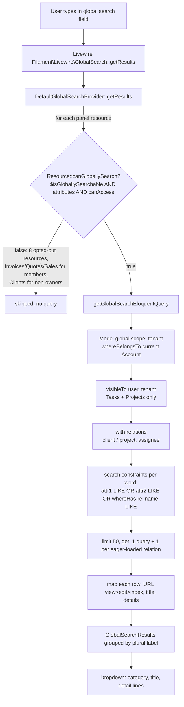

# Design: global search result details

Build: 2026-10-12-global-search-result-details (tier: standard)
Author: architect
Inputs: `plan.md` (G-*, U-*, C-*, Q-*, S-*, N-*, SC-*, F-1), `intake.md` (R-*, OBS-*). Code read at branch `claude/global-search-result-details-8f9b29`. No application code was changed.

> Note: the `architecture-diagramming` skill named in the Architect brief doesn't exist in this repo (`.claude/skills/`) or in `D:\dara\.claude`. Diagrams below use Mermaid plus a text description, so they can be read without rendering.

---

## 0. Verified facts (settles plan.md section 10 and the OBS-1 sub-bullet)

### 0.1 Installed version
- `composer.lock` and `vendor/composer/installed.json` both list **`filament/filament` v5.10.1**. `filament/support` and `filament/tables` are also v5.10.1. `plan.md` (M1, section 8) and `intake.md` OBS-1 say "Filament v4". That's wrong, but the global-search API below is the v5.10.1 code as read in `vendor/filament/filament/src/Resources/Resource/Concerns/HasGlobalSearch.php`. Vendor lives in the main checkout (`D:\dara\projects\freelance\vendor`). The worktree has no `vendor/`.

### 0.2 Global-search API (v5.10.1, `HasGlobalSearch` trait, used by `Filament\Resources\Resource`)

| Member | Exact signature / default | Notes for this build |
|---|---|---|
| `protected static bool $isGloballySearchable = true;` | Default `true`. | Opt-out: redeclare as `protected static bool $isGloballySearchable = false;` in the resource. |
| `canGloballySearch(): bool` | `$isGloballySearchable && count(getGloballySearchableAttributes()) && static::canAccess()` (plus a panel opt-in mode this app doesn't use). | **No page check.** A resource is searchable if it has a title attribute and `canAccess()` passes. |
| `getGloballySearchableAttributes(): array` | `[$recordTitleAttribute]`, or `[]` if there's no title attribute. | Dotted entries (`client.name`) become `whereHas('client', ...)` / `orWhereHas`. |
| `getGlobalSearchResultDetails(Model $record): array` | `[]`. Typed `array<string, string>` (label => value). | Must keep the `Model $record` parameter type (it's an override). Narrow the type with `@param` PHPDoc. |
| `getGlobalSearchEloquentQuery(): Builder` | `static::getEloquentQuery()` | Hook for member scoping and `with(...)`. |
| `getGlobalSearchResultUrl(Model $record): ?string` | Order: (1) nested resource (`getParentResourceRegistration()`) returns **`null`**; (2) `view` page and `canView` gives the view URL; (3) `edit` page and `canEdit` gives the edit URL; (4) `canView` gives the **index URL `?tableAction=view&tableActionRecord=<key>`**; (5) `canEdit` gives the index URL with `tableAction=edit`; (6) otherwise `null`. | Results with a blank URL are dropped in `getGlobalSearchResults()`. |
| `getGlobalSearchResults(string $search)` | Query, then attribute constraints (search split into words: every word must match at least one attribute), then `modifyGlobalSearchQuery()`, then `limit(50)`, then map to `GlobalSearchResult(title, url, details, actions)`, then `filter()`. | 50 rows max per resource (`$globalSearchResultsLimit`). |
| Provider | `DefaultGlobalSearchProvider::getResults()` loops over `Filament::getResources()`, skips any resource where `! canGloballySearch()`, and groups results under `getPluralModelLabel()`. | |
| Search field visibility | `FilamentManager::isGlobalSearchEnabled()` is true if **any** panel resource `canGloballySearch()`. | If every resource in a panel opts out, that panel loses its search field. This matters for the admin panel (see 0.4). |

### 0.3 Tenancy in global search
- `Panel::boot()` calls `$resource::registerTenancyModelGlobalScope($panel)` for every resource when the panel has tenancy (`BelongsToTenant.php:128`). That adds a model **global scope** that runs only when `Filament::getCurrentPanel() === $panel` and a tenant is set. It calls `scopeEloquentQueryToTenant()`, which is `whereBelongsTo($tenant, 'account')` for `HasAccount` models and `whereHas('accounts', ...)` for `User` via `MemberResource`.
- The scope is attached to the **model**, so it covers the global-search base query, `whereHas` subqueries from dotted attributes (`client.name`, `project.name`), and eager loads (`with('client')`). C-1 and SC-8 hold without extra code. **The scope stays in place when a resource opts out of global search**: it comes from panel boot, not from searchability.
- Side effect: `User` is tenant-scoped in the app panel (registered by `MemberResource`). An eager-loaded `assignee` who has left the account loads as `null`, and that detail is omitted (see 3.6).
- Tests: Livewire tests skip panel boot. The existing `bindFilamentTenant()` helper (`tests/Pest.php:98`) already sets the panel, boots it, and sets the tenant. Use it.

### 0.4 The two open technical facts in plan.md

**(a) CurrencyResource pages (Q-10, R-2.1, SC-10).** `app/Filament/Admin/Resources/Currencies/CurrencyResource.php:74-79` registers only `'index' => ManageCurrencies::route('/')`. **No view or edit page.** Under the plan's own outcome rule, R-2.1 is closed as **not applicable**, and the design makes **no change to CurrencyResource**. See deviation D-2: the plan's rule assumed "no page" meant "already unsearchable", and that's false.

**(b) Default behavior (OBS-1 sub-bullet, OBS-15, Q-4).** Verified against vendor code. It differs from what the intake assumed:
1. Searchable attributes default to the title attribute only. Details default to empty. **Confirmed.**
2. "Only searchable if it has a view/edit page" is **false**. Any resource with a title attribute and `canAccess()` is searchable. Page-less resources link to their **index** with `tableAction=view` (or `edit`). Today that means **Sales, Members, Units, Categories, Bank details, Invitations** (app panel) and **Currencies** (admin panel) all return results. Sales' title is its numeric id.
3. With no policies registered (only `CommentPolicy` exists), `canAccess()` falls back to `canViewAny()` and **allows**. Settings-cluster resources don't override `canAccess()`, and Filament's resource authorization doesn't consult `SettingsCluster::canAccess()`. So by code reading (not exercised at runtime), **members currently get Settings results** (bank names, invitation emails, member names) in global search, even though the Settings navigation is hidden from them. The explicit opt-outs in S-2 close this. It strengthens G-4.
4. Nested Project Tasks (OBS-15): `getGlobalSearchResultUrl()` returns `null` for nested resources, so its rows are dropped. **SC-3 already holds today**, but the query still runs (up to 50 rows wasted per search). The explicit opt-out (Q-7) removes that query.
5. EmailTemplateResource has no `$recordTitleAttribute`, so it's already unsearchable. The opt-out (Q-9) just makes that explicit.

### 0.5 Visibility rules found in list tables (G-4, C-2)
- Tasks: `TasksTable.php:30-37`. A member sees only `assigned_user_id = Auth::id()` (F-1).
- **Projects: `ProjectsTable.php:18-25`. A member sees only projects where they're in `assignees` (`project_user` pivot).** `plan.md` section 5 note: "If Architect finds one, rule G-4/C-2 applies: search must match the list's visibility." It's found and applied below. This isn't a deviation: the plan pre-authorized it.
- Clients: `ClientResource::canAccess()` returns `isOwner` only. Managers and members get no Client results. Invoices, Quotes and Sales: `! isMember`. Global search inherits all of these through `canGloballySearch()`.

---

## 1. System structure

No schema change, no new route or page, no new dependency (C-4). The changes:

| Layer | File | Change |
|---|---|---|
| Model | `app/Models/Task.php` | New local scope `scopeVisibleTo(Builder $query, User $user, Account $account): void` |
| Model | `app/Models/Project.php` | New local scope `scopeVisibleTo(Builder $query, User $user, Account $account): void` |
| Table (refactor, no behavior change) | `app/Filament/App/Resources/Tasks/Tables/TasksTable.php` | `modifyQueryUsing` calls `->visibleTo(Auth::user(), Filament::getTenant())` |
| Table (refactor, no behavior change) | `app/Filament/App/Resources/Projects/Tables/ProjectsTable.php` | Same |
| Support | `app/Filament/App/Common/GlobalSearch/GlobalSearchDetails.php` (new) | Static formatting helpers shared by the five app resources |
| Resources (included) | Clients, Projects, Invoices, Quotes, Tasks (top-level) | Searchable attributes, details, global-search query |
| Resources (excluded) | BankDetails, Categories, Invitations, Members, Units, EmailTemplates, Sales, nested Project Tasks | `protected static bool $isGloballySearchable = false;` |
| Resource (admin) | `CurrencyResource` | **No change** (0.4a, D-2) |
| Tests | `tests/Feature/GlobalSearch/*.php` (new) | See section 6 |

### 1.1 Why a model scope (decision)

Options considered for "search shows only what the list shows" (Q-6, F-1, 0.5):

| Option | Verdict |
|---|---|
| A. Copy the `when(isMember, where...)` closure into each resource's `getGlobalSearchEloquentQuery()` | Rejected. It duplicates the rule in two places per model, and they will drift. |
| B. Override `TaskResource::getEloquentQuery()` / `ProjectResource::getEloquentQuery()` | Rejected for this build. It would also scope edit/view route binding, relation selects and so on, which changes non-search behavior (N-7) and goes beyond the plan. See finding FND-1. |
| **C. Local Eloquent scope on the model, called by both the table and the global-search query** | **Chosen.** One definition of "who sees which tasks/projects". Follows the existing local-scope convention (`Task::scopeBillable(Builder $query): void`, `Invoice::scopeOrderByStatusThenDueDate`). Takes the `User` and `Account` explicitly, so the model never reads `Auth` or `Filament` facades. The facade calls stay in the Filament layer, like today. |

Scope contracts (behavior, not implementation):

- `Task::scopeVisibleTo(Builder $query, User $user, Account $account): void`. If `$user->isMember($account)`, add `where('assigned_user_id', $user->getKey())`. Otherwise leave the query unchanged. Must add only an `AND` constraint at the top level (no top-level `orWhere`), so it combines safely with Filament's search groups.
- `Project::scopeVisibleTo(Builder $query, User $user, Account $account): void`. If `$user->isMember($account)`, add `whereHas('assignees', fn (Builder $q) => $q->whereKey($user->getKey()))`. Otherwise unchanged.
- PHPDoc on both: `@param Builder<Task>` / `@param Builder<Project>`, plus one line saying it mirrors list visibility for members.

The table refactor gives identical SQL. It's in scope only as an extraction so the two call sites share one rule. If the Tech Lead reads N-7 as forbidding any edit to the table files, the fallback is to leave both tables as they are and call the scopes only from the resources. The design still works, but the rule then exists twice.

### 1.2 `GlobalSearchDetails` helper (decision)

`final class App\Filament\App\Common\GlobalSearch\GlobalSearchDetails`. It sits next to the existing `app/Filament/App/Common/Tables/Columns` and `Common/Schemas` (this is a new subfolder inside `Common`, not a new base folder). It keeps three of the plan's cross-cutting rules (section 5 preamble, Q-8) in one tested place, not repeated across five resources:

| Method | Contract |
|---|---|
| `public static function filled(array $details): array` | `@param array<string, string|null> $details`, `@return array<string, string>`. Drops entries whose value is `blank()` and keeps order ("A detail with no value is omitted"). |
| `public static function date(?CarbonInterface $date): ?string` | `null` gives `null`. Otherwise `$date->format('M d, Y')`. That's the app's existing short format (`MyTasksTable.php:46` `->date('M d, Y')`, `QuoteMailSent.php:177`). |
| `public static function money(string|float|int|null $amount, ?string $currencyCode): ?string` | `null` gives `null`. Formats the number with `Illuminate\Support\Number::format((float) $amount, 2)` (as `SaleConversionForm.php:25` does). If the currency code is filled, returns `"{$code} {$number}"` (e.g. `USD 1,250.00`, per Q-8). Otherwise returns just `{$number}`. No account-currency fallback (Q-8). |

Alternative considered: Filament `->money()` / `Number::currency()`, as `ClientInvoiceAmountColumn` uses. Rejected because it renders symbols (`$1,250.00`, `A$...`), and Q-8 explicitly asks for the code, which is unambiguous across clients in different currencies.

Enum labels use the enums' existing `HasLabel::getLabel()` (`TaskStatus`, `TaskPriority`, `ProjectStatus`, `InvoiceStatus`, `QuoteStatus` all implement it).

---

## 2. Architecture and data flow



Text version: the Livewire `GlobalSearch` component asks the default provider for results. The provider loops over the panel's resources and skips any whose `canGloballySearch()` is false. That covers the eight explicit opt-outs, resources blocked by `canAccess()` for the current role, and nothing else. For each remaining resource it builds `getGlobalSearchEloquentQuery()`. That query is the resource's Eloquent query (already tenant-scoped by a model global scope), plus, for Tasks and Projects only, the member visibility scope, plus eager loads. Filament then ANDs one group per search word, each group ORing the searchable attributes. It runs `LIMIT 50`, and maps each row to a title, a URL and a details array.

**Where sensitive data crosses the boundary (for the security review):**
- Only these fields leave the server in results: Client name/email/phone/currency_code; Project name, client name, status, due date; Invoice/Quote number, client name, status, amount + client currency code, due/valid-until; Task title, project name, status, priority, due date, and assignee name (owners and managers only).
- Bank details, invitation emails and tokens, member emails and roles: the resource never runs (opt-out), so none of these fields are queried or serialized (Q-3, N-6, SC-7).
- Authorization gates run before any query (`canGloballySearch()` includes `canAccess()`). Row-level filtering is the tenant scope plus `visibleTo`. Detail-level filtering is the Assignee shown only to non-members.

**Performance and bottlenecks:**
- Queries per search are at most 1 + (number of eager-loaded relations) per searchable resource the user can access: Clients 1, Projects 2, Invoices 2, Quotes 2, Tasks 3. That's at most 10 queries, independent of result count (C-3, SC-9).
- `client.name` / `project.name` are `EXISTS (... LIKE '%term%')` subqueries. They aren't indexable with a leading wildcard, but they're bounded by tenant and by `LIMIT 50`, and they match the existing table search. No index changes (no schema change in scope).
- Detail callbacks run in PHP on at most 50 rows per resource. `Auth::user()->isMember()` reads the already-loaded `accounts` relation on the authenticated user and adds no per-row query.

---

## 3. Per-resource changes (S-1, S-2, S-3, S-4)

Common to all five included resources:
- New imports as needed: `Illuminate\Database\Eloquent\Builder`, `Illuminate\Database\Eloquent\Model`, `App\Filament\App\Common\GlobalSearch\GlobalSearchDetails`.
- `getGlobalSearchEloquentQuery()` always starts from `parent::getGlobalSearchEloquentQuery()`, so tenant scoping and any future `getEloquentQuery()` override are kept.
- `getGlobalSearchResultDetails(Model $record): array` carries `@param <Model> $record` and `@return array<string, string>` PHPDoc and returns `GlobalSearchDetails::filled([...])`, with labels in the order shown.
- Titles (`$recordTitleAttribute`) are unchanged (S-1). No `getGlobalSearchResultUrl()` / `getGlobalSearchResultActions()` overrides (N-2).

### 3.1 Clients: `app/Filament/App/Resources/Clients/ClientResource.php` (R-2.7, T-2)
| Method | Value |
|---|---|
| `getGloballySearchableAttributes(): array` | `['name', 'email', 'phone']` |
| `getGlobalSearchEloquentQuery()` | **Not overridden.** No relation is read. `currency_code` is a column. |
| Details | `Email` => `email`; `Phone` => `phone`; `Currency` => `currency_code` |
| Access | Owners only (existing `canAccess`). URL: view page. |

### 3.2 Projects: `app/Filament/App/Resources/Projects/ProjectResource.php` (R-2.9, T-3)
| Method | Value |
|---|---|
| `getGloballySearchableAttributes()` | `['name', 'client.name']` |
| `getGlobalSearchEloquentQuery(): Builder` | `parent::...()->visibleTo(Auth::user(), Filament::getTenant())->with(['client'])` |
| Details | `Client` => `client?->name`; `Status` => `status?->getLabel()`; `Due` => `GlobalSearchDetails::date(due_date)` |
| Access | Everyone. Members see only assigned projects (0.5). URL: `view` page = `ProjectTaskBoard`. |

### 3.3 Invoices: `app/Filament/App/Resources/Invoices/InvoiceResource.php` (R-2.8, Q-8, T-4)
| Method | Value |
|---|---|
| `getGloballySearchableAttributes()` | `['number', 'client.name']` |
| `getGlobalSearchEloquentQuery()` | `parent::...()->with(['client'])` |
| Details | `Client` => `client?->name`; `Status` => `status?->getLabel()`; `Amount` => `GlobalSearchDetails::money(amount, client?->currency_code)`; `Due` => `GlobalSearchDetails::date(due_date)` |
| Access | Not members (existing). URL: view page. |

### 3.4 Quotes: `app/Filament/App/Resources/Quotes/QuoteResource.php` (R-2.10, Q-8, T-5)
| Method | Value |
|---|---|
| `getGloballySearchableAttributes()` | `['number', 'client.name']` |
| `getGlobalSearchEloquentQuery()` | `parent::...()->with(['client'])` |
| Details | `Client`; `Status`; `Amount` (as Invoices); `Valid until` => `GlobalSearchDetails::date(valid_until)` |
| Access | Not members (existing). URL: view page. |

### 3.5 Tasks (top-level): `app/Filament/App/Resources/Tasks/TaskResource.php` (R-2.12, Q-6, T-6)
| Method | Value |
|---|---|
| `getGloballySearchableAttributes()` | `['title', 'project.name']` |
| `getGlobalSearchEloquentQuery(): Builder` | `parent::...()->visibleTo(Auth::user(), Filament::getTenant())->with(['project', 'assignee'])` |
| Details | `Project` => `project?->name`; `Status` => `status?->getLabel()`; `Priority` => `priority?->getLabel()`; `Due` => `GlobalSearchDetails::date(due_date)`; `Assignee` => `assignee?->name` **only when `! Auth::user()->isMember(Filament::getTenant())`** (otherwise the key isn't added) |
| Access | Everyone. Members see only their own tasks. URL: edit page (no view page; `TaskResource.php:66` keeps it commented out). |

Decision: always eager-load `assignee`, even for members. It's one cheap query, and conditional `with()` adds a branch for no measurable gain.

### 3.6 Exclusions (S-2, T-7): add `protected static bool $isGloballySearchable = false;`
Place it beside the other `protected static` properties (after `$recordTitleAttribute`, or after `$cluster` where there's no title):

| Resource file | Reason (plan.md section 5) |
|---|---|
| `app/Filament/App/Clusters/Settings/Resources/BankDetails/BankDetailsResource.php` | Q-3, N-6 |
| `.../Settings/Resources/Categories/CategoryResource.php` | Q-4 |
| `.../Settings/Resources/Invitations/InvitationResource.php` | Q-3, Q-4 |
| `.../Settings/Resources/Members/MemberResource.php` | Q-4 (its tenant scope on `User` stays active, 0.3) |
| `.../Settings/Resources/Units/UnitResource.php` | Q-4 |
| `.../Settings/Resources/EmailTemplates/EmailTemplateResource.php` | Q-9 |
| `app/Filament/App/Resources/Sales/SaleResource.php` | Q-5 (title stays `id`, N-3) |
| `app/Filament/App/Resources/Projects/Resources/Tasks/TaskResource.php` | Q-7 |

### 3.7 Currencies (admin): no change (0.4a, D-2)

---

## 4. UI (wireframe level)

No new screens. Filament's existing dropdown renders each `details` entry as a `Label: value` line under the title. Categories appear in panel resource order (no `$globalSearchSort` change, N-5).

```
+-- Search: "acme" ------------------------------------------+
| Projects                                                    |
|   Website redesign                                          |
|   Client: Acme Ltd   Status: In progress   Due: Nov 03, 2026|
| Invoices                                                    |
|   INV-0042                                                  |
|   Client: Acme Ltd   Status: Sent   Amount: USD 1,250.00    |
|   Due: Oct 30, 2026                                         |
| Quotes                                                      |
|   Q-0017                                                    |
|   Client: Acme Ltd   Status: Sent   Amount: USD 900.00      |
|   Valid until: Oct 20, 2026                                 |
| Tasks                                                       |
|   Draft homepage copy                                       |
|   Project: Website redesign   Status: Open   Priority: High |
|   Due: Oct 14, 2026   Assignee: Jane Doe   (owner/manager)  |
| Clients                         (owners only)               |
|   Acme Ltd                                                  |
|   Email: ap@acme.test   Phone: +1 555 0100   Currency: USD  |
+-------------------------------------------------------------+
```
A member typing "acme" sees only the Projects they're assigned to and the Tasks assigned to them, with no Assignee line. They see no Invoices, Quotes, Clients, Sales or Settings categories.

---

## 5. Build sequence

Each step names what it depends on. Run `vendor/bin/pint --dirty --format agent` after PHP edits (CLAUDE.md). Create new classes and tests with artisan (`php artisan make:class`, `php artisan make:test --pest`), passing `--no-interaction`.

1. **Model scopes** (no deps). Add `Task::scopeVisibleTo` and `Project::scopeVisibleTo` (1.1). `.ai/rules/models.md` (enum columns as strings) isn't touched by this. No other `.ai/rules` file matches the paths in scope (`index.md`: migrations, models, Services, Mcp/Tools). `app/Filament/**` and `tests/**` have no rule file.
2. **Table refactor** (depends on 1). Swap the inline closures in `TasksTable.php:30-37` and `ProjectsTable.php:18-25` for `->visibleTo(Auth::user(), Filament::getTenant())`. Write test group T-VIS-TABLE (section 6) and run it, plus the existing `tests/Feature/TasksTableCompletedFilterTest.php`.
3. **`GlobalSearchDetails` helper** (no deps). Create it with `php artisan make:class` (path per 1.2).
4. **Exclusions** (no deps). Add the eight `$isGloballySearchable = false` declarations (3.6). Write test group T-EXCL.
5. **Clients** (depends on 3). Then **Invoices** and **Quotes** (depend on 3). Then **Projects** (depends on 1, 3). Then **Tasks** (depends on 1, 3). Write each resource's test group in section 6 with its step.
6. **Cross-cutting tests** (depend on 4 and 5): tenant isolation, N+1, the Livewire smoke test.
7. Run `php artisan test --compact tests/Feature/GlobalSearch tests/Feature/TasksTableCompletedFilterTest.php`, then Pint, then ask the user to run the full suite (CLAUDE.md Pest rules).

Steps 3 and 4 can run in parallel with 1 and 2.

---

## 6. Test plan (S-5, SC-1..SC-10)

Conventions followed (from `tests/Feature/**`): Pest closures, `uses(RefreshDatabase::class);` at the top of each file, `beforeEach` with factories, `bindFilamentTenant($user, $account)` and `makeAccountUser($account, AccountRole::X)` from `tests/Pest.php`, folders grouped by domain, `->with([...])` datasets for roles.

Files:
- `tests/Feature/GlobalSearch/GlobalSearchResultsTest.php`: attributes, details, formatting, N+1.
- `tests/Feature/GlobalSearch/GlobalSearchVisibilityTest.php`: tenancy, roles, member scoping, exclusions, table parity.

Fixture rules (from existing tests):
- Owner with pivot role: `$account = Account::factory()->create(); $owner = makeAccountUser($account, AccountRole::Owner);` (as in `InvoiceTableSortingTest.php:18-19`). `isOwner()` reads the pivot, and `ClientResource::canAccess()` requires it.
- `clients.currency_code` has an FK to `currencies.code`. Create `Currency::factory()->create(['code' => 'USD'])` first.
- **Create other-tenant records before `bindFilamentTenant()`.** Filament's tenancy creation observer reassigns new records to the bound tenant (see the comment at `SaleResourceTest.php:260`), as `InvoiceTableSortingTest` does.
- Use distinctive search terms (`'Zephyr'`) and fixed dates (`$this->travelTo(...)`, or explicit `due_date`) so assertions don't depend on faker values.
- Act through the resource's static API: `XResource::getGlobalSearchResults('term')` returns a `Collection<GlobalSearchResult>`. Assert on `->title`, `->url`, `->details`. For cross-resource checks, use `Filament::getGlobalSearchProvider()->getResults('term')->getCategories()`, keyed by `XResource::getPluralModelLabel()`. Don't hard-code label strings.

### GlobalSearchResultsTest.php
| ID | Test | Covers |
|---|---|---|
| T-CLI-1 | Owner searching a client's email and, separately, its phone returns that client. Details equal `['Email' => ..., 'Phone' => ..., 'Currency' => 'USD']`. | SC-1, R-2.7 |
| T-CLI-2 | A client with no phone or currency gets details without those keys. | "omit blank" rule |
| T-PRJ-1 | Searching the client name returns the project. Details are `Client`, `Status` (label), `Due` as `M d, Y`. The URL is the `view` page. | SC-2, R-2.9 |
| T-INV-1 | Searching the client name returns the invoice with `Amount` = `USD 1,250.00` (amount 1250, client USD) and `Due` formatted. | SC-2, Q-8 |
| T-INV-2 | A client with no currency gives `Amount` = `1,250.00`. | Q-8 fallback |
| T-QUO-1 | Same as T-INV-1 for quotes, with `Valid until`. | SC-2, R-2.10 |
| T-TSK-1 | Searching the project name returns the task. Details are `Project`, `Status`, `Priority`, `Due`, `Assignee` (owner viewing). The URL is the top-level edit page. | R-2.12 |
| T-TSK-2 | Viewed by a member (own task): details have no `Assignee` key. | plan section 5 Tasks row |
| T-N+1 | Dataset over Projects, Invoices, Quotes and Tasks. Create **at least 2** matching records (Laravel only flags lazy loads on multi-model results). Call `Model::preventLazyLoading()`, then `getGlobalSearchResults()`. Expect no exception and a result count ≥ 2. Reset with `Model::preventLazyLoading(false)` in `afterEach`. | SC-9, C-3 |

### GlobalSearchVisibilityTest.php
| ID | Test | Covers |
|---|---|---|
| T-VIS-TSK | Member M, tasks "Zephyr A" (assigned to M) and "Zephyr B" (assigned to another user). M's `TaskResource::getGlobalSearchResults('Zephyr')` titles are only A. The owner's (and a manager's, as a dataset) are A and B. | SC-4, Q-6 |
| T-VIS-PRJ | Member M is in `assignees` of project P1, not P2. M's search returns only P1. The owner's returns both. | 0.5, G-4 |
| T-VIS-TABLE | Parity: for member M, `Livewire::test(ListTasks::class)->assertCanSeeTableRecords([A])->assertCanNotSeeTableRecords([B])`, and the same for `ListProjects` with P1/P2. Guards the step-2 refactor. Note that `ListTasks` hides completed tasks by default, so use non-completed fixtures. | C-2, refactor safety |
| T-ROLE | Dataset of member, manager and owner. `canGloballySearch()` on Invoice, Quote and Sale is false for member. Client is true only for owner. | SC-5, C-2 |
| T-EXCL | Dataset of the 8 excluded resource classes. As **owner**, `canGloballySearch()` is false. Also, provider-level: create a Category, Unit and BankDetail named "Zephyr" plus a Sale, search "Zephyr" as owner, and assert none of those plural labels appear in `getCategories()`. | SC-6, SC-7, Q-3, Q-4, Q-7 |
| T-DUP | A task in a project. Searching its title returns exactly one result across the provider (only under `TaskResource::getPluralModelLabel()`). | SC-3 |
| T-TENANT | Accounts A and B each have a client/project/invoice/quote/task named "Zephyr" (B created before binding A). As A's owner, every provider category contains only A's records (compare titles/URLs, or record keys parsed via `getUrl`). | SC-8, C-1 |
| T-LW | Smoke test: `Livewire::test(\Filament\Livewire\GlobalSearch::class)->set('search', 'Zephyr')->assertSee('Zephyr Labs')->assertSee('USD 1,250.00')->assertDontSee(<bank name>)`. Checks that details render through the real component. | end-to-end |

Not tested: CurrencyResource (unchanged, D-2), Filament's own URL resolution, and search splitting (framework behavior).

---

## 7. Deviations from plan.md and findings for the Tech Lead

- **D-1 (version).** Filament is **v5.10.1**, not v4 (plan section 8 M1 and skills, OBS-1). The API and behavior described here are verified in v5.10.1 vendor code. No impact on scope.
- **D-2 (Currencies, Q-10/R-2.1/SC-10).** CurrencyResource has no view/edit page. The plan's outcome rule therefore applies: **R-2.1 is not applicable and nothing changes.** But the rule's premise ("stays unsearchable") is false: Currencies **are** globally searchable today, by `code`, and link to `/admin/currencies?tableAction=view&tableActionRecord=<code>`. There's no `ViewAction` on that table, so the user lands on the list with no modal. I didn't opt it out either. CurrencyResource is the admin panel's only resource, so opting it out would **remove the admin panel's search field** entirely (`isGlobalSearchEnabled()`), and that's a regression the plan didn't intend. **For PM/Tech Lead:** if U-3 should be met, adding `['code', 'name']` attributes and `Name`/`Symbol` details needs no page (C-4 holds) and costs about 15 minutes. The weak index landing is the only drawback.
- **D-3 (Projects member scoping).** Members' project search is restricted to assigned projects (0.5). This applies the plan's own conditional note in section 5, so it isn't a scope change. I'm flagging it because S-3 only names Tasks.
- **D-4 (table files touched).** `TasksTable` and `ProjectsTable` are edited as a no-behavior-change extraction to share the scope (1.1). The fallback, if N-7 is read strictly, is described in 1.1.
- **FND-1 (out of scope, existing).** `TaskResource` and `ProjectResource` don't scope `getEloquentQuery()`, so a member can probably open another user's task edit page or an unassigned project by direct URL. Search no longer reveals those records after this build, but the route-level gap remains. Suggested follow-up: a policy or a `getEloquentQuery()` override using the same `visibleTo` scope.
- **FND-2 (existing leak, fixed by S-2).** By code reading (0.4b-3), members currently get Settings-cluster results (bank names, invitation emails, member names) in global search. The explicit opt-outs close this. T-EXCL should also run as a member to lock it in, and adding the member role to its dataset costs nothing.
- **FND-3.** Intake OBS-1's assumed default ("needs a view/edit page") is wrong (0.4b). The plan's decisions don't depend on it, because the exclusions are explicit, but SC-6 was failing today, not merely "at risk".
